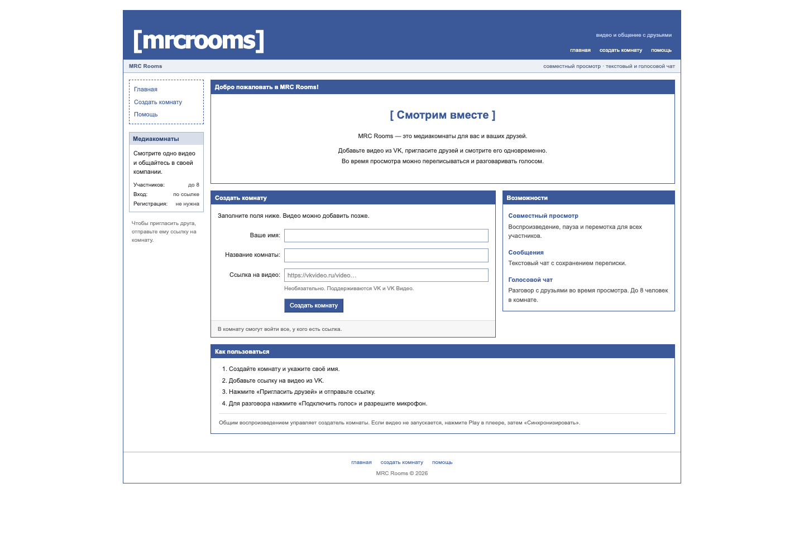

# MRC Rooms

Пет-проект для совместного просмотра VK Видео: медиакомнаты, текстовый и голосовой
чат для компании до 8 человек. Интерфейс вдохновлён Facebook 2004–2006 годов.



## Возможности

- Создание комнаты и приглашение по ссылке без регистрации.
- Разбор ссылок VK / VK Видео и официальный встроенный плеер.
- Общее воспроизведение, пауза и перемотка под управлением создателя.
- Текстовый чат с сохранением истории.
- Голос через WebRTC: подключение, отключение и выключение микрофона.
- Список участников и диагностика голосового подключения.
- Адаптивный интерфейс для компьютера и телефона.

## Как устроено

**Backend:** Python 3.11+, Flask, waitress, SQLite с WAL.  
**Frontend:** JavaScript ES modules, HTML, CSS, официальный VK Video Player API.  
**Голос:** WebRTC mesh; SDP и ICE передаются через сервер, аудио — между браузерами
или через настроенный TURN-сервер.

```text
Браузеры ── HTTPS ── Caddy ── waitress / Flask ── SQLite
    │                             │
    ├── официальный VK-плеер       └── чат, присутствие, сигнализация
    └── WebRTC audio ↔ другие участники / TURN
```

Состояние комнаты обновляется примерно раз в секунду. Плеер проверяет
рассинхронизацию каждые 5 секунд и корректирует разницу больше 2 секунд.
Голосовая комната на 8 человек создаёт 28 попарных соединений.

## Быстрый запуск

Нужны Python 3.11+ и SQLite 3.35+ (в актуальных сборках Python уже есть).

```sh
python3 -m venv .venv
.venv/bin/python -m pip install -r requirements.txt
.venv/bin/python app.py
```

Откройте **http://127.0.0.1:8010**. Создайте комнату, введите имя и добавьте видео.
По умолчанию база и ключ сессии создаются в `instance/`.

Для общей команды используйте кнопки **«Воспроизвести всем»**, **«Пауза»** и
**«Перейти»** под плеером. Кнопки внутри VK управляют локальным плеером;
автоматическая синхронизация возвращает его к позиции комнаты. Браузер может
сначала потребовать нажать Play на обложке видео.

## Docker и деплой

Локально:

```sh
cp .env.example .env
docker compose up -d --build
```

Приложение откроется на **http://127.0.0.1:8010**. SQLite хранится в именованном
Docker volume, отдельно от образа. В контейнере приложение работает без root.

Для сервера с доменом и автоматическим HTTPS:

```sh
# Сначала задайте DOMAIN и постоянный SECRET_KEY в .env.
docker compose -f compose.yaml -f compose.production.yaml up -d --build
```

Пошаговые инструкции, DNS, постоянный диск, обновления и резервные копии:
**[Руководство по деплою](docs/DEPLOYMENT.md)**.

GitHub хранит исходники и запускает CI. **GitHub Pages не запускает Python-сервер**.
Для приложения нужен сервер или платформа с Python/Docker и постоянным диском.

## Настройки

| Переменная | Назначение | По умолчанию |
|---|---|---|
| `MRC_ENV` | `development` или `production` | `development` |
| `SECRET_KEY` | Постоянный секрет сессий, минимум 32 символа в production | Файл `instance/session.key` в development |
| `MRC_DATA_DIR` | Каталог SQLite и локального ключа | `instance/`; в Docker `/data` |
| `HOST` | Адрес прослушивания | `127.0.0.1`; в Docker `0.0.0.0` |
| `PORT` | Порт waitress | `8010` |
| `COOKIE_SECURE` | `1` для HTTPS в development | В production всегда включён |
| `ICE_SERVERS_JSON` | Массив серверов STUN/TURN | STUN Google |
| `DOMAIN` | Домен для Caddy | Настраивается в `.env` |

Docker Compose читает `.env` автоматически. При запуске `python app.py`
приложение читает переменные окружения; файл `.env` автоматически не загружается.

## Голос через интернет

Микрофон доступен на `localhost` / `127.0.0.1` или по **HTTPS**.
STUN помогает установить прямое соединение, но не ретранслирует звук.
Для мобильных операторов, корпоративных сетей и некоторых NAT нужен **TURN**:

```dotenv
ICE_SERVERS_JSON='[{"urls":"stun:stun.l.google.com:19302"},{"urls":["turn:turn.example.com:3478?transport=udp","turns:turn.example.com:5349?transport=tcp"],"username":"YOUR_USER","credential":"YOUR_CREDENTIAL"}]'
```

Укажите работающий TURN-сервис и реальные реквизиты, затем пересоздайте контейнер.
Смена TURN-настроек требует обновления страниц участников. Эти реквизиты
передаются браузерам, поэтому используйте временные или ограниченные реквизиты,
а не административный ключ провайдера.

Кнопка **«Диагностика подключения»** показывает состояния ICE, типы кандидатов
и наличие TURN. Ошибки также записываются в серверный лог как `voice_diagnostic`.
Содержимое сообщений, аудио, SDP, IP-адреса кандидатов и TURN-пароли туда не попадают.
Запись «микрофон включён» означает доступ к микрофону; «на связи» у другого
участника означает установленное соединение с ним.

## Проверки

Серверные тесты используют временные базы:

```sh
.venv/bin/python -m unittest test_app -v
```

Браузерная проверка двух участников, чата, синхронизации и настоящей передачи
аудиопакетов с виртуальными микрофонами:

```sh
.venv/bin/python -m pip install -r requirements-dev.txt
.venv/bin/python -m playwright install chromium
.venv/bin/python browser_check.py
```

На macOS используется установленный Google Chrome, если он есть. Проверка
поднимает временный сервер на порту 8011. VK API в ней подменён, доступ к реальному
видео не нужен. В GitHub Actions запускаются серверные тесты на Python 3.11/3.13,
браузерная проверка и сборка Docker с проверкой запуска на свежем volume.
CI не публикует образ и не запускает платные облачные ресурсы.

Для десятиминутного прогона восьми участников на уже работающем сервере:

```sh
.venv/bin/python -u browser_check.py \
  --soak-seconds 600 \
  --base-url https://YOUR-DOMAIN \
  --video-url 'https://vkvideo.ru/video-OWNER_ID_VIDEO_ID' \
  --report /tmp/mrc-rooms-soak.json
```

Используйте реальную ссылку вместо примера. Без `--video-url` используется
тестовый плеер; с ним проверяется настоящий VK-плеер и декодирование кадров.
Таймер начинается после подключения всех участников и начала воспроизведения.
В конце видео ставится на паузу, браузеры закрываются, сохраняется JSON-отчёт.

Проверенный сценарий: 8 сессий на одном Mac, 10 минут реального VK-видео,
28 голосовых соединений, 80 сообщений у каждого участника, 4082 запроса без ошибок.
Максимальное измеренное расхождение видео — 1,89 секунды. Это проверка одного
компьютера и сети; она не заменяет проверку TURN между разными сетями.

## Ограничения и данные

- Любой, у кого есть ссылка, может войти в комнату. Отдельных аккаунтов и модерации нет.
- Право создателя хранится в сессии браузера. Удаление cookie или смена `SECRET_KEY`
  лишает браузер этого права. Держите секрет постоянным.
- Чат хранится в SQLite без шифрования на уровне приложения. Сервер не записывает голос.
- Комнаты и переписка сохраняются до удаления базы; автоматической очистки истории нет.
- Неактивные участники перестают учитываться через 35 секунд. Сигналы старше двух
  минут не выдаются; устаревшие записи очищаются при новых подключениях.
- Встраивание некоторых VK-видео запрещено, другим нужна ссылка `video_ext.php`
  с `hash`. Закрытые или удалённые видео могут не работать. Поиска по каталогу нет.
- Видео загружается напрямую из VK; приложение не скачивает и не раздаёт видеофайлы.
- Проект рассчитан на небольшие компании. SQLite размещайте на локальном постоянном
  диске, запускайте одну реплику приложения.

## Структура

```text
app.py                    HTTP API, сессии, SQLite, состояние комнат
media.py                  Разбор ссылок VK
static/                   Плеер, WebRTC, чат, стили
templates/                HTML-шаблоны
test_app.py               Серверные и deployment-тесты
browser_check.py          Проверки браузеров и длительный прогон
Dockerfile                Образ приложения
compose*.yaml             Локальный запуск / сервер с HTTPS
deploy/Caddyfile           Reverse proxy и сертификаты
.github/workflows/ci.yml   Автоматические проверки
```
